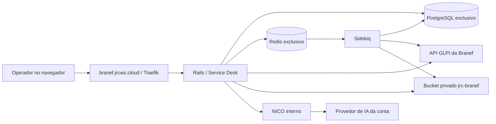

# Como funciona o ambiente Branef

Este é o guia da revisão em homologação. O resultado de cada implantação deve ser
conferido no relatório correspondente: código publicado, imagem publicada e
containers em execução são evidências diferentes.

## Componentes



O Rails atende a interface e autoriza as operações. O Sidekiq executa tarefas
demoradas, como coleta e exportação. PostgreSQL guarda contas, permissões,
configurações cifradas, projeções e recibos. Redis atende às filas e funções
auxiliares; ele não é a origem oficial dos chamados GLPI.

O GLPI continua sendo a origem dos seus chamados. A aplicação não cria um chamado
nativo editável para cada chamado remoto. Os dados de pesquisa e indicadores são
uma projeção derivada, identificada por conexão, versão e horário de coleta.

NICO é um serviço interno. Suas ações passam pela autorização do Rails e pelo
mesmo executor GLPI. Alterações exigem a confirmação do operador; o usuário técnico
aparece no GLPI, enquanto o JRC registra quem solicitou e confirmou a ação.

## Compose, Environment e banco

O Compose define serviços, imagens, comandos, redes, volumes e os nomes das
variáveis usadas pelos containers. O Environment do projeto no Dokploy fornece
os valores dessas variáveis. Escrever uma variável no Environment não a entrega
automaticamente a um container: ela precisa estar referenciada no Compose.

| Configuração | Onde fica | Para que serve |
|---|---|---|
| `JRC_IMAGE` | Environment | Imagem imutável compartilhada por preparação, Rails e Sidekiq |
| `NICO_IMAGE` | Environment | Imagem do runtime NICO |
| `BRANEF_DOMAIN` | Environment | Host público; o Compose monta `FRONTEND_URL=https://...` |
| `SECRET_KEY_BASE` e `ACTIVE_RECORD_ENCRYPTION_*` | Environment | Segredos Rails e proteção dos dados cifrados |
| `BRANEF_POSTGRES_PASSWORD` | Environment | Senha do PostgreSQL exclusivo |
| `BRANEF_REDIS_PASSWORD` | Environment | Senha do Redis exclusivo |
| `STORAGE_*` | Environment | Acesso restrito ao bucket privado da aplicação |
| `SMTP_*` e `MAILER_SENDER_EMAIL` | Environment | Envio de e-mail |
| `NICO_SERVICE_TOKEN` | Environment | Autenticação entre Rails e NICO |
| `BRANEF_NICO_ACCOUNT_ID` | Environment | Conta autorizada no runtime; não é ID de usuário |
| URL, tokens, entidades e usuários GLPI | Banco, pela configuração administrativa | Conexão e escopo por conta |
| Chave, modelo e limites de IA | Configuração da conta | Provedor e cobrança próprios da Branef |

Não há uma URL de Super Admin separada para preencher no ENV. O endereço público
da instalação é o mesmo; o caminho de administração e as permissões determinam
qual interface o usuário pode acessar. Definir `SUPER_ADMIN_EMAIL` em um arquivo
não cria nem promove um usuário automaticamente.

Na instalação nova, o serviço PostgreSQL inicializa o banco e o usuário declarados
no Compose. O serviço de preparação aplica schema/migrations. Redis não exige
criar um banco SQL. Os volumes preservam esses dados entre recriações de containers.
Na instalação existente, atualizar a imagem não exige recriar bancos nem volumes.

## Como tratar as chaves

Somente numa instalação nova, gerar valores independentes no servidor:

```sh
openssl rand -hex 64
openssl rand -hex 32
```

O primeiro comando atende à chave longa Rails; repetir o segundo separadamente
para cada outra senha/chave/token. Não usar a mesma saída para tudo. Guardar os
valores no Environment, não no código ou neste relatório. O arquivo
`branef.env.example` contém os nomes e exemplos sem segredos.

Na Branef já instalada, preservar as chaves existentes. Trocar chaves de
criptografia pode impedir a leitura dos tokens GLPI já cifrados; trocar uma senha
de banco apenas no ENV não altera a senha que já existe no PostgreSQL.

## Fonte GLPI e escopo

Cada conta possui uma configuração de origem. `primary_source` seleciona GLPI nas
telas operacionais. Uma conexão desabilitada apresenta indisponibilidade;
não troca automaticamente os chamados por registros locais.

Entidade GLPI e unidade JRC são identificadores diferentes. O mapeamento relaciona
os dois. A raiz GLPI tem ID 0 válido. Um mapeamento de entidade não concede acesso
a todas as suas subentidades; os vínculos autorizados precisam ser explícitos.
Os agentes também precisam de suas permissões, unidades e mapeamentos de identidade.
As novas unidades de raiz/SEDE não devem receber concessões automáticas a agentes.

Uma referência remota contém conta, conexão, tipo de objeto, ID remoto e entidade.
Ela impede confundir, por exemplo, o chamado local 6303 com o chamado GLPI 6303.
Mudar credenciais ou mapeamentos invalida versões e resultados antigos. Substituir
o endpoint depois de existir histórico exige uma migração de origem controlada.

O GLPI distingue entidades permitidas ao perfil e entidades ativas na sessão.
No modo principal, o conector seleciona as entidades permitidas na sua sessão
temporária, mantendo os filtros e a autorização JRC. Isso não concede permissões
novas ao perfil GLPI nem altera chamados.

## Coleta, operação e arquivos

1. Configurar conexão e mapeamentos pela interface administrativa; validar perfil
   e direitos anunciados. Não interpretar autenticação HTTP200 como acesso a tudo.
2. Iniciar a coleta e acompanhar o recibo. A cobertura informa entidades,
   registros observados/indexados, falhas e data. Coleta parcial não comprova o total.
3. Consultar detalhes e executar ações permitidas. A operação registra intenção
   antes do envio, verifica permissões/revisão e confirma o resultado na origem.
4. Em timeout ou resultado indeterminado, consultar/reconciliar o recibo.
   Não reenviar com uma chave nova para tentar resolver a incerteza.
5. Nos modelos de chamado, a integração precisa descobrir/aplicar o modelo e seus
   obrigatórios: a API GLPI não executa automaticamente o fluxo do formulário web.
   Metadados negados ou campos obrigatórios sem correspondência impedem uma criação
   segura; não devem ser ignorados.
6. Anexos GLPI são enviados/baixados pelo backend autorizado. Retirar uma associação
   não significa excluir um documento compartilhado. Os limites operacionais são
   20 MiB para envio e 50 MiB para download, sujeitos a limites menores na origem.
7. CSV é gerado em segundo plano, exige cobertura completa e nova verificação para
   download. O arquivo fica privado, expira em 24 horas e não pode ser reutilizado
   depois de uma revogação. A verificação não é um snapshot transacional do GLPI.

O bucket da aplicação e o repositório de documentos GLPI são armazenamentos
diferentes. O S3 guarda arquivos da aplicação, como exportações; o conector não
copia automaticamente todos os documentos GLPI para esse bucket.

## Como conferir uma atualização

- Conferir o SHA aprovado e o digest da imagem publicada. O pipeline exige um
  laboratório GLPI aprovado no mesmo SHA antes de publicar.
- Atualizar apenas a imagem/configuração necessária do Compose Branef e implantar.
- Conferir preparação concluída, migrations, Rails, Sidekiq, PostgreSQL, Redis e
  NICO; verificar HTTPS e a revisão realmente em execução.
- Validar a conta correta, permissões, unidades, coleta, contagens/IDs e restrições
  reais. Separar testes simulados, laboratório real e observação do servidor cliente.
- Preservar segredos, volumes, SMTP, armazenamento e mecanismos de backup existentes.
  Não apagar filas ou volumes para resolver uma implantação.

Um erro403 significa acesso negado; não significa ausência de chamados. Um404
também não comprova, isoladamente, que o histórico foi excluído. Os ajustes de
permissão precisam ser confirmados com a administração do GLPI do cliente.
